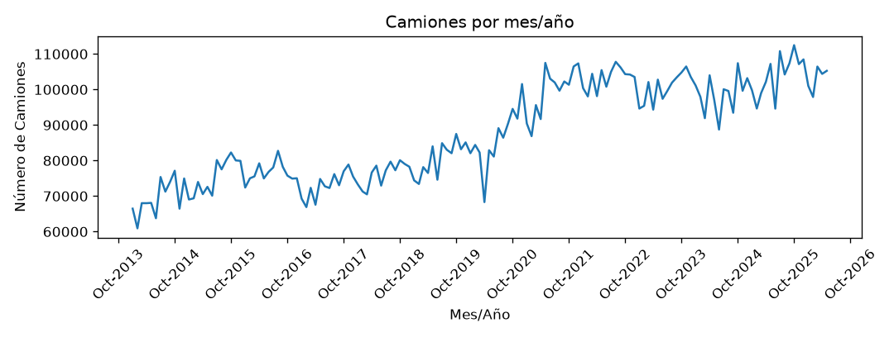
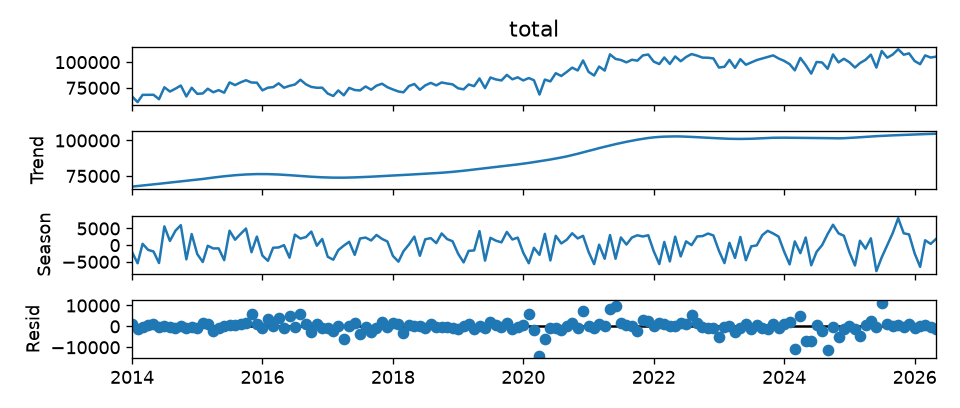
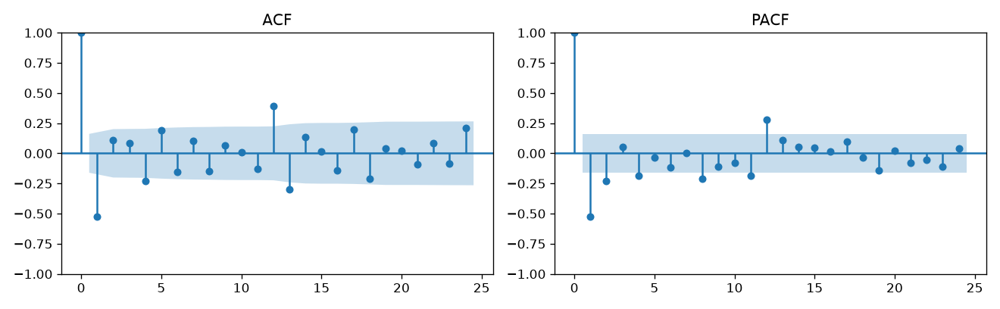
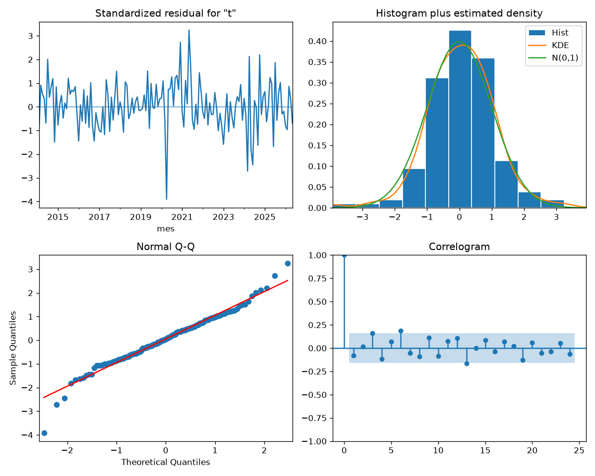

# Informe del miniproyecto 1

Llene cada sección reemplazando los marcadores `{{...}}`, sin quitar las
secciones. Las cifras salen de lo que imprime `python miniproyecto.py` y las
figuras son las que ese guion deja en `figuras/`. Las fórmulas van en LaTeX
(`$...$` o `$$...$$`).

## 1. La serie

{{Qué mide la serie, de dónde sale (fuente y licencia), frecuencia, periodo y
número de observaciones. Por qué el grupo la eligió.}}

La revisión del calendario mensual, de enero de 2014 a mayo de 2026, mostró
149 observaciones y ningún mes faltante. Por ello, no fue necesario imputar
ni interpolar datos. La función `preparar` verifica que la serie no esté
vacía ni contenga valores ausentes; si los encuentra, detiene la ejecución
para exigir una decisión explícita sobre su tratamiento.

Para identificar posibles datos atípicos se aplicó el criterio de
$1{,}5\times IQR$ a los valores originales, donde:

$$
IQR = Q_3 - Q_1, \qquad
L_{\mathrm{inf}} = Q_1 - 1{,}5\,IQR, \qquad
L_{\mathrm{sup}} = Q_3 + 1{,}5\,IQR.
$$

Se obtuvo $Q_1=75\,367$, $Q_3=101\,146$ e $IQR=25\,779$ vehículos.
Los límites fueron 36.698,5 y 139.814,5 vehículos. El mínimo observado fue
60.922 y el máximo 112.471; ningún valor quedó fuera de los límites, por
lo que se detectaron **cero atípicos según este criterio**.

El IQR se calculó sobre toda la serie y no considera su orden temporal:
este resultado no descarta meses inusuales respecto de la tendencia o la
estacionalidad, que se examinan mediante la descomposición y los residuos.

La decisión aplicada en `preparar` coincide con el texto de `DECISION`,
que se incluye en la columna `decision` de la tabla de métricas:

> Sin meses faltantes; no se detectaron atípicos con el criterio 1,5 × IQR.
> Se conservaron los valores originales, sin corrección automática.

## 2. Componentes

Se aplicó una descomposición STL aditiva con periodo de 12 meses y ajuste
robusto (`robust=True`). La serie se expresa como:

$$
y_t = T_t + S_t + R_t,
$$

donde $T_t$ es la tendencia, $S_t$ la componente estacional y $R_t$ el
residuo. Las tres componentes se expresan en vehículos por mes.

La tendencia muestra un crecimiento de largo plazo: pasa de **67.411,64
vehículos en enero de 2014 a 104.681,43 en mayo de 2026**, un aumento de
37.269,79 vehículos, equivalente al **55,29 %** del nivel inicial estimado.
El crecimiento no es uniforme: la curva presenta una mayor pendiente
alrededor de 2019–2021 y variaciones más moderadas desde 2022.

Para resumir la estacionalidad se promedió la componente $S_t$ de cada mes
del calendario sobre los años disponibles. Un efecto positivo se suma al
nivel de tendencia y uno negativo lo reduce:

| Mes | Efecto estacional medio (vehículos) |
|---|---:|
| Enero | −2.450,31 |
| Febrero | −5.441,71 |
| Marzo | −91,21 |
| Abril | −1.834,54 |
| Mayo | +1.696,45 |
| Junio | −4.598,51 |
| Julio | +1.573,85 |
| Agosto | +904,56 |
| Septiembre | +2.427,20 |
| Octubre | +4.405,89 |
| Noviembre | +1.426,12 |
| Diciembre | +2.429,05 |

**Octubre tiene el mayor efecto estacional medio y febrero el menor**;
junio también presenta una reducción marcada respecto de la tendencia.
Estos valores resumen la componente estimada, cuyo efecto puede cambiar
entre años. Enero a mayo cuentan con 13 observaciones por mes y los demás
meses con 12, porque la muestra termina en mayo de 2026.

El **mayor residuo en valor absoluto corresponde a abril de 2020**, con
$R_t=-14\,007{,}81$ vehículos. Ese mes se observaron 68.302 vehículos,
frente a una tendencia estimada de 85.243,04 y un efecto estacional de
−2.933,23. La suma de tendencia y estacionalidad fue 82.309,81 vehículos;
el dato observado quedó 14.007,81 por debajo de esa suma.
Este residuo mide la desviación respecto de los componentes estimados por
STL. Su magnitud muestra que puede existir un mes inusual en su contexto
temporal debido a la pandemia.

## 3. Líneas base y backtest

Se utilizó la función común `backtest`, con los últimos 24 meses como
periodo de prueba y un horizonte de 12 meses por origen. La prueba abarca
de junio de 2024 a mayo de 2026. El primer origen es mayo de 2024, con
125 observaciones de entrenamiento desde enero de 2014; el último es
mayo de 2025, con 137 observaciones. Entre ambos se evalúan **13 orígenes
mensuales**, porque cada uno necesita disponer de sus 12 meses futuros
completos dentro de la muestra.

La ventana de entrenamiento se amplía un mes en cada origen. La función
de pronóstico recibe únicamente `serie.iloc[:corte]` y el horizonte;
las observaciones posteriores al corte se usan para calcular los errores.
En SARIMA se vuelven a estimar los coeficientes con cada entrenamiento,
manteniendo los órdenes elegidos previamente. Esta separación describe
el ajuste en cada origen; la selección de los órdenes se realiza antes
del backtest.

Los horizontes de evaluación se solapan entre orígenes. Se calculan RMSE,
MAE y MAPE sobre los 12 pronósticos de cada origen y después se promedia
cada métrica entre los 13 orígenes, tal como establece `comun.py`.

| Línea base | RMSE (vehículos) | MAE (vehículos) | MAPE (%) |
|---|---:|---:|---:|
| Ingenuo | 7.379,41 | 6.353,49 | 6,12 |
| Estacional ingenuo | 6.833,25 | 5.770,06 | 5,56 |

El ingenuo repite el último valor de entrenamiento para los 12 meses;
el estacional ingenuo repite los valores del último año observado.
**El estacional ingenuo gana en las tres métricas** y se usa como la
línea base de referencia para comparar el SARIMA.

## 4. Estacionariedad e identificación

Se aplicó la prueba Dickey–Fuller aumentada (ADF) a la serie original y a
tres transformaciones, con un nivel de significancia del 5 %. La hipótesis
nula $H_0$ es que existe una raíz unitaria; se rechaza cuando el valor p es
menor que 0,05. No rechazar $H_0$ no demuestra que la raíz exista, pero
indica que esta prueba no aporta evidencia suficiente para descartarla.

Las transformaciones comparadas fueron la diferencia regular
$\Delta y_t=y_t-y_{t-1}$, la diferencia estacional
$\Delta_{12}y_t=y_t-y_{t-12}$ y su combinación
$\Delta\Delta_{12}y_t$. Los primeros valores ausentes producidos por cada
diferencia se retiraron antes de aplicar ADF. El cálculo se realizó sobre
la serie dividida por 10.000, igual que en los modelos; este cambio de
unidad no modifica la decisión sobre la hipotesis nula.

En niveles se usó `regression="ct"`, con constante y tendencia lineal,
porque la gráfica y STL muestran crecimiento de largo plazo. En las
versiones diferenciadas se usó `regression="c"`: se permite una media
distinta de cero tras diferenciar y no se añade una tendencia lineal
determinista a los cambios. Los rezagos auxiliares se seleccionaron con
`autolag="AIC"`, dentro del máximo predeterminado de la biblioteca. Estos
parámetros y la hipótesis del contraste se describen en la
[documentación de ADF en statsmodels](https://www.statsmodels.org/stable/generated/statsmodels.tsa.stattools.adfuller.html).

| Versión | `regression` | Estadístico ADF | Valor p | Rezagos ADF | Observaciones efectivas | Rechaza $H_0$ al 5 % |
|---|---|---:|---:|---:|---:|---|
| Original | `ct` | −1,9617 | 0,62214390 | 13 | 135 | No |
| Diferencia regular | `c` | −3,8263 | 0,00264947 | 11 | 136 | Sí |
| Diferencia estacional | `c` | −2,4295 | 0,13358578 | 13 | 123 | No |
| Ambas diferencias | `c` | −4,8596 | 0,00004176 | 13 | 122 | Sí |

La columna de observaciones efectivas descuenta tanto la diferenciación
como las observaciones necesarias para la regresión ADF y sus rezagos.
Por ello, no equivale a la longitud de cada versión de la serie.

Se eligió **$d=1$ y $D=0$ como especificación inicial**. La prueba no
rechaza hipotesis nula en niveles y sí la rechaza después de una diferencia
regular. La diferencia estacional sola no logra ese rechazo. Ambas
diferencias también lo logran, pero su menor valor p no convierte esa
transformación en un mejor modelo: una diferencia regular ya proporciona
evidencia contra la no estacionariedad y conserva 148 observaciones, frente a
136 al aplicar ambas.
La ADF utilizada no es un contraste específico de raíces estacionales y
su rechazo no demuestra por sí solo todas las condiciones de
estacionariedad. Por ello, **$D=0$ es una decisión de modelado que se
contrasta después con el ajuste y los residuos**. La dependencia anual
que permanezca se estudia mediante los términos estacionales $P$ y $Q$
del SARIMA; no se interpreta $D=0$ como ausencia de estacionalidad.

La figura corresponde a la diferencia regular, con 148 observaciones,
desde febrero de 2014 hasta mayo de 2026, y muestra los primeros 24
rezagos. Se usaron bandas del 95 % calculadas con Bartlett para la ACF y
una PACF estimada por Yule–Walker sin ajuste (`method="ywm"`), con banda
aproximada de $\pm1{,}96/\sqrt{148}=\pm0{,}161$. Las bandas ACF varían
según el rezago; no se les aplica ese mismo umbral constante. Las opciones
se detallan en la documentación de
[ACF](https://www.statsmodels.org/stable/generated/statsmodels.graphics.tsaplots.plot_acf.html)
y [PACF](https://www.statsmodels.org/stable/generated/statsmodels.graphics.tsaplots.plot_pacf.html).

Los coeficientes que salen de las bandas, excluido el rezago cero, son:

| Rezago | ACF fuera de banda | PACF fuera de banda |
|---:|---:|---:|
| 1 | −0,5250 | −0,5250 |
| 2 | — | −0,2307 |
| 4 | −0,2326 | −0,1878 |
| 8 | — | −0,2110 |
| 11 | — | −0,1843 |
| 12 | +0,3904 | +0,2788 |
| 13 | −0,2976 | — |

El guion indica los mismos rezagos y coeficientes. Una raya significa que
el coeficiente queda dentro de la banda de esa función.

El pico negativo de la ACF en el rezago 1 sugiere incluir un término MA(1)
entre los candidatos. El pico anual en el rezago 12 de ambas funciones
motiva explorar términos AR y MA estacionales. Los picos adicionales no
permiten identificar un único orden de forma concluyente; se propone la
rejilla pequeña $p,q,P,Q\in\{0,1\}$, manteniendo $d=1$, $D=0$ y periodo
12, para comparar las combinaciones por AIC y revisar sus residuos.
Estas bandas se usan como guía exploratoria, no como una selección
automática del modelo.

## 5. Modelos clásicos

Se evaluaron las 16 combinaciones de $p,q,P,Q\in\{0,1\}$, manteniendo
$d=1$, $D=0$ y periodo 12. Todos los ajustes usaron las mismas 149
observaciones de la serie preparada, dividida por 10.000. La selección
se hizo por el menor AIC entre los modelos que convergieron y tuvieron
AIC finito; en esta ejecución convergieron los 16 candidatos.

| Orden $(p,d,q)$ | Orden estacional $(P,D,Q,12)$ | AIC |
|---|---|---:|
| (0,1,1) | (1,0,1,12) | 160,67 |
| (1,1,1) | (1,0,1,12) | 161,04 |
| (0,1,1) | (1,0,0,12) | 174,58 |
| (1,1,1) | (1,0,0,12) | 175,44 |
| (1,1,0) | (1,0,1,12) | 177,20 |
| (1,1,0) | (1,0,0,12) | 183,42 |
| (0,1,1) | (0,0,1,12) | 183,78 |
| (1,1,1) | (0,0,1,12) | 184,42 |
| (1,1,0) | (0,0,0,12) | 189,82 |
| (1,1,1) | (0,0,0,12) | 203,55 |
| (0,1,1) | (0,0,0,12) | 203,61 |
| (1,1,0) | (0,0,0,12) | 208,00 |
| (0,1,0) | (1,0,1,12) | 217,69 |
| (0,1,0) | (1,0,0,12) | 224,64 |
| (0,1,0) | (0,0,1,12) | 233,01 |
| (0,1,0) | (0,0,0,12) | 253,01 |

El modelo elegido fue **SARIMA$(0,1,1)(1,0,1)_{12}$**, con AIC de
160,6682. El siguiente candidato obtuvo 161,04: la diferencia de unos
0,37 puntos es pequeña, por lo que también es un candidato cercano.
Estos AIC corresponden a una muestra y escala comunes; no se mezclan con
AIC calculados sobre otras transformaciones.

Definiendo $z_t=y_t/10\,000$ y el operador de rezago $Bz_t=z_{t-1}$, la
ecuación del modelo elegido es:

$$
(1-\Phi_1B^{12})(1-B)z_t
=(1+\theta_1B)(1+\Theta_1B^{12})\varepsilon_t.
$$

Las estimaciones fueron $\theta_1=-0{,}6356$,
$\Phi_1=0{,}9994$ y $\Theta_1=-0{,}9727$, de modo que:

$$
(1-0{,}9994B^{12})(1-B)z_t
=(1-0{,}6356B)(1-0{,}9727B^{12})\varepsilon_t.
$$

No se incluyó deriva, según la configuración usada al ajustar el modelo
integrado. La varianza estimada de las innovaciones fue
$\hat\sigma^2=0{,}1403$ en la escala de $z_t$. La forma multiplicativa y
la convención de signos corresponden a la
[especificación ARIMA de statsmodels](https://www.statsmodels.org/stable/generated/statsmodels.tsa.arima.model.ARIMA.html).

Para Ljung–Box se utilizaron 148 residuos, después de descartar el primer
residuo de inicialización asociado a la diferencia regular. Se corrigieron
los grados de libertad por los términos AR y MA estimados, tanto regulares
como estacionales:

$$
k_{\mathrm{LB}}=p+q+P+Q=0+1+1+1=3, \qquad
\nu=h-k_{\mathrm{LB}}.
$$

Se pasó `model_df=3` a `acorr_ljungbox`. Los órdenes de diferenciación y
la varianza de las innovaciones no se cuentan en esta corrección por
términos AR/MA. Cada rezago debe superar `model_df` para que el contraste
tenga grados de libertad positivos, como explica la
[documentación de Ljung–Box](https://www.statsmodels.org/stable/generated/statsmodels.stats.diagnostic.acorr_ljungbox.html).
La hipótesis nula es que no hay autocorrelación en el conjunto de rezagos
del 1 al $h$ evaluado; se usó un nivel de significancia del 5 %.

| Rezago $h$ | Grados de libertad $\nu$ | Estadístico Ljung–Box | Valor p corregido | Rechaza $H_0$ al 5 % |
|---:|---:|---:|---:|---|
| 12 | 9 | 19,657525 | 0,020148 | Sí |
| 24 | 21 | 30,778844 | 0,077418 | No |

**Se detecta autocorrelación residual en el contraste hasta el rezago 12.**
Este es un contraste conjunto: no identifica por sí solo al rezago 12
como el responsable. No rechazar en el rezago 24 no elimina el rechazo
obtenido al evaluar los primeros 12. Por tanto, el diagnóstico no respalda
concluir que los residuos sean ruido blanco. La versión anterior omitía
`model_df` y daba valores p de 0,073848 y 0,160262, lo que cambiaba la
interpretación del primer contraste.

La figura muestra los residuos estandarizados, su histograma, el gráfico
Q–Q y su ACF.
La serie residual oscila alrededor de cero, pero presenta una desviación
negativa marcada en 2020 y picos positivos alrededor de 2021. El centro
del histograma se aproxima a la referencia normal, mientras que las
colas del gráfico Q–Q se apartan de la recta; la curtosis de 4,65 que
imprime el ajuste también señala colas más pesadas que la normal.
En la ACF residual quedan algunos picos fuera de las bandas, coherentes
con que el modelo no haya capturado toda la dependencia temporal.

Se conserva este modelo como el mínimo AIC de la rejilla para comparar
su desempeño predictivo, dejando explícita su limitación diagnóstica.
La elección inicial de $d=1$, $D=0$ y la rejilla pequeña pueden revisarse
en una ampliación del experimento; un menor AIC no garantiza residuos
sin autocorrelación.

La función `modelo_sarima` devuelve un pronosticador que conserva los
órdenes $(0,1,1)(1,0,1)_{12}$, pero ajusta de nuevo los coeficientes en
cada origen del backtest común. Para el ajuste divide el entrenamiento
por 10.000; después genera los 12 pronósticos y los multiplica por
10.000 para devolverlos en vehículos. No entrega valores diferenciados:
el modelo integrado produce los pronósticos en la escala de la serie
que recibió para ajustarse.

**Convergieron los 13 ajustes SARIMA**, desde el origen mayo de 2024
hasta mayo de 2025. El guion imprime cada origen, el tamaño de su
entrenamiento, el horizonte y la confirmación de convergencia. La función
detiene la ejecución si un ajuste no converge o si sus pronósticos no
son finitos, para impedir que ese ajuste aporte métricas sin revisión.

El promedio obtenido en el backtest común fue **RMSE de 4.494,34
vehículos, MAE de 3.747,91 vehículos y MAPE de 3,59 %**. Las tres medidas
son menores que las de la mejor línea base, el estacional ingenuo.
La convergencia confirma que el optimizador terminó según su criterio;
la autocorrelación residual detectada antes sigue siendo una limitación
del modelo.

{{La variable exógena: qué es, por qué se conoce de antemano y si mejora al
SARIMA.}}

## 6. Tabla de métricas

{{Copie aquí `resultados/metricas.csv` como tabla de Markdown, ordenada por
RMSE.}}

| Modelo | Decisión | RMSE | MAE | MAPE (%) |
|---|---|---|---|---|
| {{...}} | {{...}} | {{...}} | {{...}} | {{...}} |

## 7. Conclusión

{{El mejor modelo clásico, cuánto mejora a la mejor línea base en cada
métrica y en qué meses o tramos sigue fallando. Es el modelo que el
miniproyecto 2 debe superar.}}
